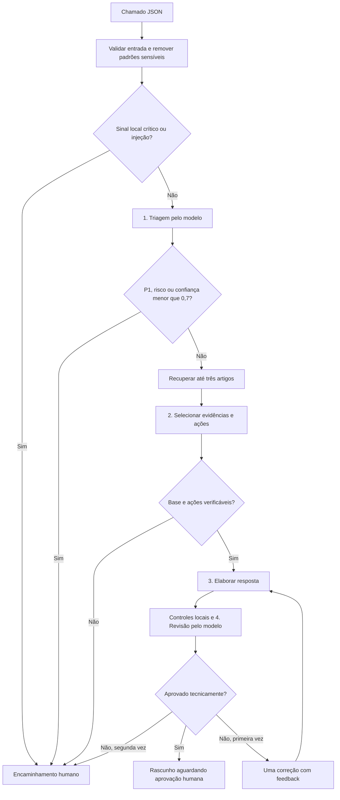

# Arquitetura e decisões de engenharia

## Fluxo



Ausência de artigos interrompe o fluxo antes da fundamentação. Falhas de contrato permitem uma nova tentativa da mesma etapa. Falhas persistentes e erros operacionais encerram com encaminhamento humano. Nenhum nó envia mensagens ao cliente.

## Componentes e fronteiras

| Componente | Responsabilidade |
|---|---|
| CLI | Ler entrada, escolher explicitamente provedor e salvar saídas |
| Contratos | Validar envelope de entrada e tipos/valores das saídas de cada etapa |
| Política e prompts | Definir trabalho do modelo e seus limites |
| Provedor | Transportar solicitações e interpretar o envelope da API |
| Recuperação | Selecionar artigos por termos encontrados e categoria |
| Pipeline | Encadear etapas, aplicar controles e decidir encaminhamento |
| Avaliador | Comparar resultados com rótulos esperados e gerar evidências |

O cliente Groq não conhece regras de negócio. O pipeline não conhece cabeçalhos HTTP. O simulador implementa a mesma interface `complete`, mas gera resultados por regras e não lê os rótulos esperados do avaliador.

As saídas completas de triagem e fundamentação ficam registradas para inspeção. As etapas seguintes recebem uma seleção de campos: lacunas especulativas não são repassadas como requisitos. A resposta e a revisão usam somente o plano fundamentado e o relato. O pipeline também aplica a política `outros/P3`, preservando sinais P1.

## Formato e validação

`src/contracts.mjs` é a fonte dos schemas usados tanto no prompt quanto na requisição de Structured Outputs. Os objetos têm todos os campos obrigatórios e recusam campos adicionais. O validador local implementa apenas os tipos, enums, propriedades, itens e limites numéricos usados aqui; não declara compatibilidade geral com todos os recursos de JSON Schema.

Além dos tipos, o pipeline verifica:

- resumo e mensagem não vazios, com limites de tamanho;
- revisão coerente: aprovação exige todos os critérios positivos e lista de problemas vazia;
- artigo existente no conjunto recuperado;
- citação literal com pelo menos 12 caracteres;
- ação copiada exatamente de `steps` de um artigo citado;
- fontes da resposta pertencentes à fundamentação;
- padrões de promessas, pedidos de segredo e exposição de dados;
- canais sem evidência, afirmações de consulta operacional não realizada, coleta de identificadores/anexos e confusão sobre o canal de titularidade;
- sugestões de mudança de permissão, promessas de consulta futura e retorno não previsto na base;
- consulta de faturas apresentada antes das perguntas para análise, sem depender de respostas prévias;
- identificadores internos de artigos ausentes da mensagem ao cliente, com fontes estruturadas preservadas;
- condição e canal no passo de verificação de titularidade, quando essa orientação aparece na resposta.

Os controles de conteúdo reconhecem também solicitações em listas e hífens Unicode. A versão 1.2.0 trata negações das novas promessas sem descartar instruções positivas posteriores, além da condição financeira com “Aguardar”. A remoção de credenciais distingue separadores explícitos de conjunções e descrições comuns; o texto "senha e não consigo entrar" mantém sua negação. Os padrões continuam limitados e não reconhecem toda credencial ou construção linguística.

A versão 1.2.1 acrescenta os controles editoriais `self_service_prerequisite` e `internal_reference_in_message`, com uma tentativa de correção e encaminhamento se a falha persistir. As fontes continuam em `source_ids` e nas evidências; somente sua apresentação na mensagem muda. O relatório passa a identificar a versão ativa do avaliador pelo mesmo número do pipeline. Relatórios antigos mantêm os metadados originais; hashes e snapshots permitem verificar sua proveniência.

Verificar a existência de uma citação não prova que ela responde à pergunta. A etapa de fundamentação, a revisão e o atendente avaliam a pertinência semântica. A aprovação automática da rubrica não elimina essa limitação.

## Recuperação

Cada artigo recebe um ponto por palavra-chave encontrada no assunto ou na mensagem. Havendo pelo menos um termo, recebe mais dois pontos se sua categoria coincidir com a triagem. Ordenam-se os resultados por pontuação e ID, mantendo os três primeiros.

Categoria sem sobreposição textual não recupera artigo. O algoritmo é deliberadamente simples para tornar o capstone auditável. Pode perder sinônimos ou recuperar coincidências superficiais. Para ampliar a base, comparar busca lexical com embeddings/híbrida e manter avaliação específica de recuperação.

## Falhas e limites

O cliente usa o endpoint fixo do Groq e rejeita redirecionamentos. Por padrão, permite até duas repetições de rede/HTTP 429 ou 5xx. O cabeçalho `Retry-After` é respeitado; se exigir espera superior a dez segundos, retorna `groq_retry_later`, sem antecipar uma repetição. Essa política segue o significado do cabeçalho na [documentação de limites do Groq](https://console.groq.com/docs/rate-limits).

Há timeout por tentativa e orçamento global do pipeline. Uma etapa permite no máximo duas tentativas de contrato. Há no máximo uma revisão da resposta. Com as configurações padrão, o teto combinatório é 36 tentativas HTTP: seis posições de etapa, duas tentativas de contrato e três de transporte. O orçamento global de 120 segundos normalmente encerra antes desse extremo. Alterar `GROQ_MAX_RETRIES` altera esse teto.

HTTP 400, 401 e outros erros de cliente não são repetidos automaticamente. Erros são expostos como códigos estáveis, sem reproduzir corpo de erro, cabeçalhos ou credenciais. A referência dos status está em [Groq — Error Codes](https://console.groq.com/docs/errors).

## Observabilidade e privacidade

Cada saída identifica provedor, modelo, versões e hashes dos prompts e da base. O trace contém nomes de etapas, tentativas, códigos e duração. Os tokens informados pelo provedor são somados inclusive quando uma resposta é rejeitada por JSON inválido. Requisições que falham podem ter consumo não informado; a contagem não substitui a cobrança da conta.

Rejeições locais de conteúdo aparecem como `validacao_local` no trace. O executor da matriz conserva as saídas intermediárias e espera conforme a cota informada pelo Groq. Além da espera entre casos, pode aguardar antes de iniciar uma etapa, sem consumir o timeout HTTP durante essa pausa. O orçamento global do pipeline continua valendo; as pausas antes de etapas são discriminadas no relatório.

O texto bruto do chamado não aparece no trace. Resumos, fatos e rascunhos são conteúdo derivado e ainda podem conter informações sensíveis não reconhecidas pelos padrões. Os arquivos de saída exigem o mesmo cuidado dos chamados de origem. O modo de arquivo `0600` é apenas uma preferência em plataformas que o respeitam; no Windows, permissões dependem das ACLs.

## Reutilização como biblioteca

```javascript
import { runPipeline } from './src/pipeline.mjs';
import { GroqProvider } from './src/providers/groq.mjs';

const provider = new GroqProvider(); // GROQ_API_KEY deve estar no ambiente
const result = await runPipeline({
  id: 'CHAMADO-100',
  subject: 'Dúvida sobre CSV',
  message: 'Como exporto um relatório CSV?'
}, { provider });

// Exibir em uma fila de revisão; não enviar automaticamente.
console.log(result.status, result.response);
```

O provedor é configurável por construtor e o pipeline aceita uma base e um bundle de prompts carregados. Isso permite integrar uma interface de atendente no futuro, preservando o fluxo de aprovação.
